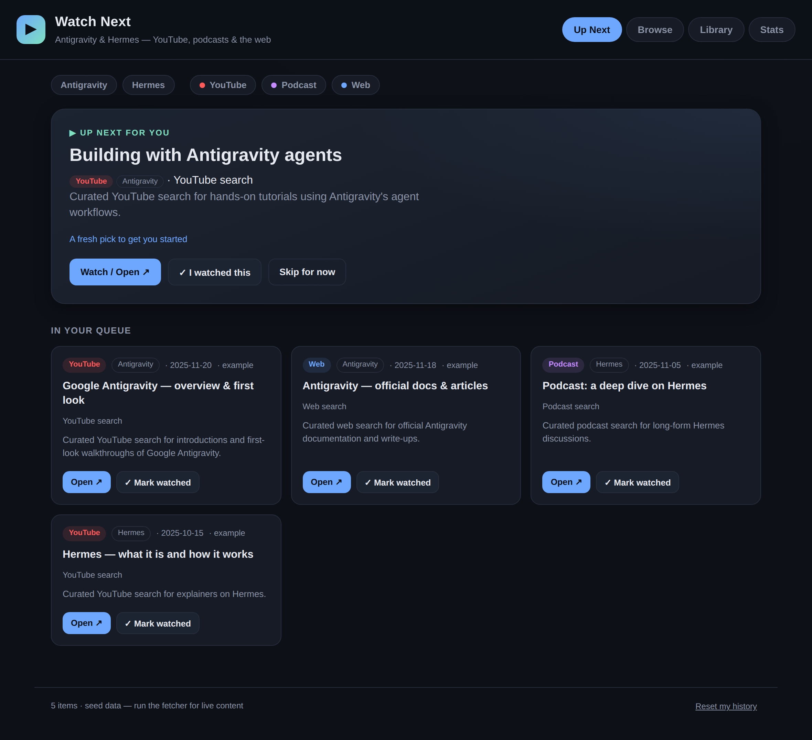

# Antigravity & Hermes — Watch Next

A personal watch-tracker and recommender for **Antigravity** and **Hermes**
content across **YouTube, podcasts, and the web**. It shows you what to watch
next, and when you mark something watched it asks whether you **liked it** —
then uses your 👍 / 👎 to sharpen future picks.



> ⚠️ **Security lab target.** The Cloud Run backend in this folder is
> **intentionally vulnerable** (SQL injection, path traversal, a plaintext DB
> password, an end-of-life base image) so the fixes can be demonstrated with the
> CodeMender + Wiz MCP lab. See [SECURITY-LAB.md](SECURITY-LAB.md). Do not run it
> anywhere you care about.

## How it works

```
 MySQL `sources` ──► fetch_media.py ──► MySQL `items` ──► Flask API ──► web app
   (where to look)     (aggregator)      (the content)    /api/catalog   (Up Next / Browse / Library / Stats)
```

- **Flask + MySQL on Cloud Run.** `data/sources.json` and `data/catalog.json`
  are the seed: on start-up the backend loads them into the MySQL tables
  `sources`, `items` and `meta`, and the web app reads the catalog from
  `/api/catalog`. Your watched/liked history is still stored in your browser's
  `localStorage`, so it stays on your device.
- **Still works as a static site.** With no backend (plain `http.server`,
  GitHub Pages) the web app falls back to `data/catalog.json`.
- **The recommender** ranks unwatched items by your taste: topics, sources, and
  creators you've 👍'd score higher; 👎'd ones score lower; newer items get a
  recency boost. The top pick appears as the **Up Next** hero with a short
  "recommended because…" explanation.
- **The watched → liked loop:** mark an item watched (on the hero or any card)
  and it moves to your **Library** with a "Did you like it?" prompt. Rating it
  feeds straight back into the ranking.

## Quick start

The app must be served over HTTP (browsers block `fetch` of local files over
`file://`).

```bash
# from the repo root
python3 -m http.server 8000
# then open http://localhost:8000/web/
```

or use the helper:

```bash
./scripts/serve.sh        # serves on http://localhost:8000/web/
```

It ships with **seed data** (real YouTube/web *search* links) so it works
immediately. Run the fetcher to replace it with live content.

## Pulling live content

1. Edit **`data/sources.json`**:
   - `youtube.search_terms` / `youtube.channel_ids` — what to index on YouTube
   - `podcasts.feeds` — podcast RSS feed URLs
   - `websites.pages` — pages to scrape links from (with an optional CSS-ish hint)
   - `match` — regexes that tag an item as **Antigravity** and/or **Hermes**
2. For YouTube, get a free **YouTube Data API v3** key
   (Google Cloud Console → APIs & Services → enable *YouTube Data API v3* →
   create an API key) and export it:
   ```bash
   export YOUTUBE_API_KEY=your_key_here
   ```
3. Run the fetcher (Python 3.9+, **no third-party packages required**):
   ```bash
   python3 scripts/fetch_media.py
   ```
   It writes `data/catalog.json`. Reload the web app to see the new items.

Each source degrades gracefully — a missing API key or an unreachable feed is
skipped with a warning, and the other sources still run.

### Keep it fresh automatically

Run the fetcher on a schedule, e.g. a cron entry:

```cron
0 8 * * *  cd /path/to/antigravity-hermes-watchlist && YOUTUBE_API_KEY=... python3 scripts/fetch_media.py
```

## Run the backend locally

```bash
pip install -r requirements-dev.txt
python -m app.main            # http://127.0.0.1:8080/  (SQLite file, no MySQL needed)
```

With `DB_HOST` unset the backend uses a local SQLite file, which is also what
the tests use. To run against real MySQL the way Cloud Run does:

```bash
cp .env.example .env          # set DB_PASSWORD
docker compose up --build     # http://localhost:8080/
```

In database mode the fetcher reads its sources from MySQL and writes items back
to it: `DB_HOST=... python3 scripts/fetch_media.py` (or `--db`).

## Deploy to Cloud Run

Deployment is Terraform ([terraform/](terraform/main.tf)). It creates one Cloud
Run service with two containers — `web` (Flask + gunicorn) and a `mysql`
sidecar it reaches on `127.0.0.1:3306` — plus the Artifact Registry repo, a
no-roles runtime service account, and the required APIs.

```bash
gcloud auth application-default login     # credentials for Terraform
cd terraform
cp terraform.tfvars.example terraform.tfvars   # set project_id
terraform init
terraform plan                            # always review first
terraform apply
terraform output service_url
```

`terraform apply` also builds the image: it runs `gcloud builds submit` on this
folder (so the gcloud CLI must be installed and logged in) and tags the image
with a hash of the source files, so a code change produces a new build and a
new revision. To deploy an image you built yourself, set `image` in
`terraform.tfvars` and the build step is skipped.

**Without Terraform:** `scripts/deploy_cloud_run.sh` deploys the same service
from [cloudrun/service.yaml](cloudrun/service.yaml) with plain `gcloud`
(`--dry-run` to preview, `--public` to allow unauthenticated access). Use one
method or the other for a given project, not both — they manage the same
`watchlist` service. Note that the YAML carries a fixed lab-only MySQL password.

Things to know:

- **The MySQL root password** is generated by Terraform unless you set
  `db_root_password`. It ends up in Terraform state and in the Cloud Run
  revision as plaintext — that is lab finding CM-0003, left in on purpose.
  Keep the state file local and out of git (the repo `.gitignore` covers it).

- **The database is ephemeral.** MySQL's data directory is an in-memory
  volume, so each new instance starts empty and is re-seeded from `data/*.json`.
  Anything the fetcher wrote is lost on restart. `maxScale` is 1 because every
  instance has its own private database. For durable data, point `DB_HOST` at
  Cloud SQL for MySQL instead of the sidecar.
- **Private by default.** Reach the service with the command from
  `terraform output proxy_command`. The lab's "internet-facing" findings need
  `allow_unauthenticated = true`; only set that in a lab project.
- **Cost.** `minScale: 1` with CPU always allocated keeps one instance running;
  run `terraform destroy` when the lab is over.

### Static hosting

Any static host still works. For **GitHub Pages**: serve the repo root and visit
`/web/`; the app reads the committed `data/catalog.json`.

## Project layout

```
app/
  main.py          # Flask app: serves web/ and the /api routes
  db.py            # MySQL (Cloud Run) / SQLite (local, tests) access + seeding
  notes.py         # topic notes served by /api/notes
terraform/
  main.tf          # Cloud Run service (web + MySQL sidecar), image build, IAM
data/
  sources.json     # seed for the `sources` table (where to look + topic rules)
  catalog.json     # seed for the `items` table (and the static-hosting fallback)
  notes/           # topic notes
scripts/
  fetch_media.py   # YouTube + podcast RSS + website aggregator (stdlib only)
  serve.sh         # convenience static server (no backend)
tests/
  unit/            # legitimate behaviour
  poc/             # exploit PoCs for the lab (pass while vulnerable)
patches/           # reference fixes for the lab findings
web/
  index.html       # the app shell (Up Next / Browse / Library / Stats)
  app.js           # recommender + watched/liked flow + localStorage
  styles.css       # dark UI
```

## Privacy

Your watch history and ratings never leave your browser. There is no analytics
and no account; the only server call the web app makes is fetching the catalog.

## License

MIT — see [LICENSE](LICENSE).
